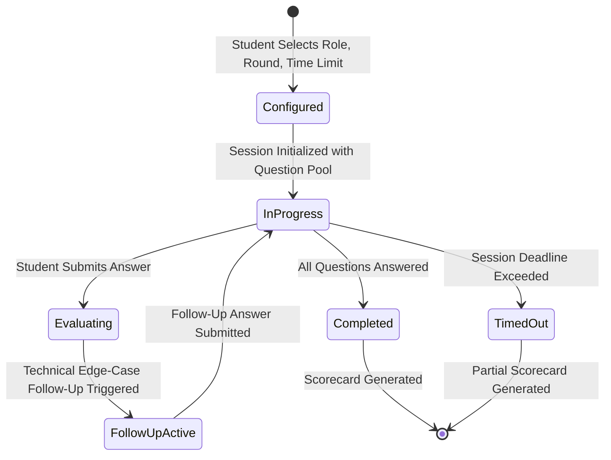

# Nexora Advanced Interview Simulator

## 1. Product Context & Objectives

Standard interview preparation platforms often present isolated questions with static model answers.
The **Nexora Advanced Interview Simulator** (`/interview/simulator`) recreates the realistic pressure, unpredictability, and conversational flow of a real technical screening round:
- **Time Pressure**: Strict server-enforced countdown deadlines.
- **Dynamic Follow-Up Questions**: Adaptive probes that test edge cases, scalability bottlenecks, and trade-off justifications based on what the candidate just said.
- **Multi-Round Coverage**: Technical core, coding logic, SQL database design, HR fit, and behavioral scenarios.
- **Detailed Scorecard**: Comprehensive performance breakdown across conceptual depth, trade-off awareness, and communication clarity.

---

## 2. Session Lifecycle & Server Deadlines

### Deadline Enforcement
- When a session starts, `expiresAt` is set to `new Date(Date.now() + durationMinutes * 60 * 1000).toISOString()`.
- The client timer updates every second. Even if the candidate pauses, refreshes the page, or restarts their browser, the session state is restored from `localStorage` and the deadline continues counting down monotonically.
- If the countdown reaches `00:00`, inputs are locked and a partial evaluation is compiled to prevent artificial time extension.

---

## 3. Dynamic Follow-Up Generation Engine

In real technical rounds, interviewers rarely accept a high-level answer without digging deeper.
When candidate answers touch on architecture, databases, or algorithms:
1. The engine checks answer length, key technical vocabulary, and categories (`technical`, `programming`, `sql`).
2. If the initial answer is sufficiently detailed, a targeted follow-up question is dynamically generated:
   - *Example Probes*: "How would your design scale if write traffic increased by 100x?", "What happens during network partitions under this database topology?", "What are the cache invalidation trade-offs?"
3. The candidate responds directly to the follow-up before moving to the next primary question.

---

## 4. Structured Evaluation & Scorecards

Upon completing the session:
- Individual questions receive scores (0–100) based on conceptual depth, trade-off analysis, and structure.
- Strengths and actionable improvement recommendations are highlighted.
- The completed session awards `+75 XP` and logs an official interview record for unified analytics.
