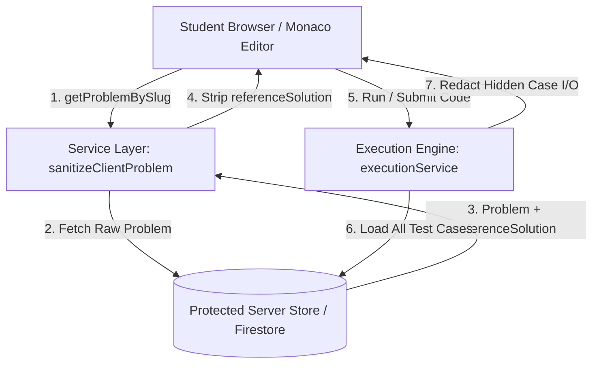

# Nexora CodeLab — Starter Code & Reference Solution Privacy Architecture

**Document Version:** 1.0.0  
**Effective Date:** 2026-10-17  
**Module:** Nexora CodeLab Problem Library & Code Editor  
**Audience:** Platform Architects, Engineering Team, Security Auditors, Educational Content Admins  

---

## 1. Executive Summary & Root Cause Analysis

### 1.1 The Issue Discovered
In earlier builds of Nexora CodeLab, opening certain problems (such as *“Reverse Words in a String”*) automatically displayed the complete reference solution directly inside the student's Monaco editor. For example, the Python workspace opened with:

```python
def reverse_words(s: str) -> str:
    # Write your solution here
    words = s.split()
    return " ".join(reversed(words))
```

This defeated the instructional purpose of the coding practice module by giving away the answer before the student had attempted the problem.

### 1.2 Root Cause Analysis
A full architectural audit of the problem data model, seed catalogs, database service, and editor initialization pipeline traced the issue to two interconnected factors:

1. **Seed Data Conflation (`src/data/seedProblems.ts`):**  
   The initial problem seed data authored for the platform bundled complete working implementations inside the `starterCode` dictionary across all supported languages (Python, JavaScript, TypeScript, Java, and C++). Rather than containing clean function skeletons with `pass` / `# Write your solution here`, the working solution logic was embedded directly in the starter dictionary.
2. **Data Model Lacked Separation of Concerns (`src/types/codelab.ts`):**  
   The `Problem` TypeScript interface only had a `starterCode: StarterCodeMap` field and lacked an explicit, protected field or subcollection for private server-side reference solutions (`referenceSolution`). As a result, the same code intended as reference implementation was loaded as the default editor starter template.
3. **Absence of Server-Side DTO Sanitization:**  
   The query methods `getProblems()` and `getProblemBySlug()` in `src/services/codelabService.ts` forwarded the entire problem record directly to the frontend without stripping sensitive server-side fields.

---

## 2. Architectural Separation of Concepts

To prevent regression and guarantee academic integrity, the platform data model and execution pipeline now formally separate the following concepts:

| Architectural Concept | Storage Location | Accessibility / Visibility | Security Controls |
| :--- | :--- | :--- | :--- |
| **Problem Statement** | `Problem.description` | Public to authenticated students | Markdown rendering in Left Pane |
| **Input / Output Formats** | `Problem.inputFormat`, `Problem.outputFormat` | Public | Rendered under Problem Statement |
| **Constraints & Complexity** | `Problem.constraints`, `Problem.expectedComplexity` | Public | Rendered under Constraints tab |
| **Visible Sample Examples** | `Problem.examples` & `ProblemTestCase` (`isPublic: true`) | Public | Displayed with input, expected output, and explanation |
| **Language-Specific Starter Code** | `Problem.starterCode` | Public | Loaded into student editor upon opening, language switch, or Reset |
| **Private Reference Solution** | `SEED_REFERENCE_SOLUTIONS` / `Problem.referenceSolution` | **Private / Server-Only** | Strictly stripped by `sanitizeClientProblem()` before reaching client |
| **Hidden Evaluation Tests** | `SEED_TEST_CASES` (`isPublic: false`) / `/problems/{id}/testCases` | **Private / Server-Only** | Omitted from client queries; inputs/outputs stripped from execution responses |
| **Submissions & Mastery** | `submissions` collection & `getTopicMasteryForUser()` | Student & Admin only | Protected by Firestore owner-only security rules |

---

## 3. Language Starter Code Standards

All supported languages in Nexora CodeLab adhere to a unified template convention:

### 3.1 Python (`python`)
Provides the function signature with typed parameters, return type hint, comment prompt, and `pass`, followed by a standard I/O execution wrapper:

```python
def reverse_words(s: str) -> str:
    # Write your solution here
    pass


# Test execution wrapper
import sys

if __name__ == "__main__":
    input_str = sys.stdin.read().strip()
    print(reverse_words(input_str))
```

### 3.2 JavaScript & TypeScript (`javascript`, `typescript`)
Provides JSDoc/TypeScript typed function signatures with clean default returns (`""`, `[]`, `-1`, or `false`) and standard input stream readers:

```javascript
/**
 * @param {string} s
 * @return {string}
 */
function reverseWords(s) {
  // Write your solution here
  return "";
}

// Test execution wrapper
const fs = require('fs');
const input = fs.readFileSync(0, 'utf-8').trim();
console.log(reverseWords(input));
```

### 3.3 Java (`java`)
Provides a standard `Solution` class containing the static algorithm method returning default values, alongside a `Scanner` CLI wrapper:

```java
import java.util.*;

public class Solution {
    public static String reverseWords(String s) {
        // Write your solution here
        return "";
    }

    public static void main(String[] args) {
        Scanner scanner = new Scanner(System.in);
        if (scanner.hasNextLine()) {
            String line = scanner.nextLine();
            System.out.println(reverseWords(line));
        }
    }
}
```

### 3.4 C++ (`cpp`)
Provides standard namespace, function signature returning default value, and `cin`/`getline` I/O wrapper:

```cpp
#include <iostream>
#include <string>

using namespace std;

string reverseWords(string s) {
    // Write your solution here
    return "";
}

int main() {
    string line;
    if (getline(cin, line)) {
        cout << reverseWords(line) << endl;
    }
    return 0;
}
```

### 3.5 SQL (`sql`)
Provides schema context comments and a skeleton query with a non-matching placeholder (`WHERE 1 = 0;`) that requires the student to write the actual query:

```sql
-- Write your SQL query statement below
-- Schema: Employee (id, name, salary, departmentId), Department (id, name)
SELECT 
    d.name AS Department,
    e.name AS Employee,
    e.salary AS Salary
FROM Employee e
JOIN Department d ON e.departmentId = d.id
WHERE 1 = 0; -- Replace with your solution
```

---

## 4. Server-Side Security & Data Privacy Enforcement

Security cannot rely on client-side CSS or UI hiding. Nexora enforces defense-in-depth across three tiers:



### 4.1 Service DTO Sanitization (`src/services/codelabService.ts`)
```typescript
export function sanitizeClientProblem(problem: Problem): Problem {
  const safeProblem = { ...problem };
  delete safeProblem.referenceSolution;
  return safeProblem;
}
```
Both `getProblems()` and `getProblemBySlug()` pass all problem records through `sanitizeClientProblem()` before returning data to client callers.

### 4.2 Hidden Test Case Redaction (`src/services/executionService.ts`)
When evaluating test suites:
- `tc.isPublic === true`: Diagnostic `input`, `expectedOutput`, and `actualOutput` are provided for student learning.
- `tc.isPublic === false`: `input`, `expectedOutput`, and `actualOutput` are strictly set to `undefined`. Only the pass/fail boolean, execution runtime, and memory are included in the response.

### 4.3 Firestore Security Rules (`firestore.rules`)
```rules
    // Problems Catalog
    match /problems/{problemId} {
      allow read: if isAuthenticated() && (resource.data.isPublished == true || isAdmin());
      allow write: if isAdmin();

      // Test Cases Subcollection: Hidden tests protected from client queries
      match /testCases/{testCaseId} {
        allow read: if isAuthenticated() && (resource.data.isPublic == true || isAdmin());
        allow write: if isAdmin();
      }

      // Private Reference Solutions Subcollection: Strictly restricted to server / admins
      match /solutions/{solutionId} {
        allow read, write: if isAdmin();
      }
    }
```

---

## 5. Editor Lifecycle & Evaluation Behavior

### 5.1 Editor Initialization
1. When navigating to `/codelab/problems/:slug`, `ProblemWorkspacePage` loads the sanitized problem DTO.
2. The editor is initialized with `problem.starterCode[defaultLanguage]`.
3. The editor renders only the starter template. No reference solution exists anywhere in memory or the DOM.

### 5.2 Language Switching
1. If the student has made edits, a browser confirmation dialog warns that unsubmitted changes will be replaced.
2. Upon confirmation, the editor loads `problem.starterCode[newLanguage]`.

### 5.3 Reset Button
1. Clicking **Reset** presents a confirmation dialog.
2. Upon confirmation, `code` resets back to `problem.starterCode[selectedLanguage]`.

### 5.4 Run Button vs. Submit Button
- **Run (Sample Tests):** Executes the student's current code strictly against visible sample test cases (`isPublic: true`). Allows rapid feedback on edge cases described in the problem statement.
- **Submit (Official Assessment):** Evaluates the student's code against the complete test suite (both sample and hidden evaluation tests). Generates a durable submission record in the user's history and recalculates topic mastery.
- **Unmodified Starter Code Guard:** Running or submitting unmodified starter code containing `pass`, `TODO`, `WHERE 1 = 0;`, or identical template skeletons fails evaluation with `wrong_answer` and a diagnostic message: *“placeholder starter code did not produce expected output”*.

---

## 6. Automated Test Verification

The test suite in `src/test/starterCodeAndSolutionPrivacy.test.ts` provides automated regression testing covering:

1. **Starter Code Integrity:**
   - Problem opens with starter skeleton matching exact specification.
   - All 6 seed problems verified free of reference solution leakage across all languages.
2. **Language Switching & Reset:**
   - Verified language switcher retrieves language-specific starter template.
   - Verified Reset button restores intended skeleton.
3. **Data Privacy:**
   - Verified `referenceSolution` is stripped by `sanitizeClientProblem`.
   - Verified private test cases redact `input`, `expectedOutput`, and `actualOutput`.
4. **Execution Correctness:**
   - Unmodified starter code fails with `wrong_answer`.
   - Run operation executes only visible sample tests.
   - Submit operation evaluates both sample and hidden tests.
   - Genuine solutions pass all tests and receive `accepted` verdict.
5. **System Cohesion:**
   - Full test suite passes 13 test files and 150 automated test cases with 0 failures.
