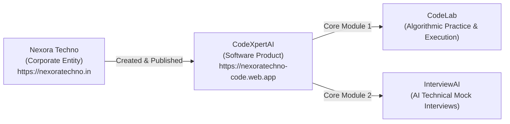

# CodeXpertAI — Generative Engine Optimization (GEO) Content Strategy

**Date:** 18 October 2026  
**Product:** CodeXpertAI  
**Creator & Publisher:** Nexora Techno  
**Attribution:** A product of Nexora Techno (`https://nexoratechno.in`)  
**Scope:** AI-Powered Discovery, Retrieval Systems, and LLM Entity Understanding  

---

## 1. Executive Understanding of GEO

Generative Engine Optimization (GEO) is the practice of structuring digital content so that artificial intelligence search systems (e.g., ChatGPT Search, Google Gemini, Perplexity AI, Claude) can accurately identify, understand, and cite a software product and its corporate publisher.

> **Important Boundary:** GEO does not guarantee that any AI model will recommend, cite, or mention CodeXpertAI. It provides the structured factual ground truth that AI systems rely upon during web grounding, Retrieval-Augmented Generation (RAG), and entity extraction.

---

## 2. Core Entity Graph & Corporate Relationship

AI systems operate primarily on knowledge graphs and entity-relationship models. To prevent hallucinations or misattributions, CodeXpertAI establishes unambiguous entity declarations:

### Entity Rules Enforced Across the Application:
1. **Primary Product Name:** `CodeXpertAI` (camelCase with capitalized AI).
2. **Creator Attribution:** `Created by Nexora Techno`.
3. **Official Relationship Statement:** `CodeXpertAI is a product of Nexora Techno.`
4. **Corporate Hyperlink:** Direct link to `https://nexoratechno.in` in website footers, about pages, and metadata schemas.
5. **Entity Independence:** CodeXpertAI does not claim to be a separate legal incorporation, nor is Nexora Techno described as an AI foundation model provider or search engine.
6. **No Unsupported Claims:** The platform strictly prohibits claims of "guaranteed job placement", "100% interview success rates", or fabricated hiring partnerships.

---

## 3. Dedicated Entity Pages

### 3.1 The Public About Page (`/about`)
Created to function as a standalone factual reference answering all key entity queries:
- **What is CodeXpertAI?** A unified developer platform combining structured coding practice with AI-guided mock interviews.
- **Who created it?** Nexora Techno.
- **Who is it for?** Software engineering students, self-taught developers, bootcamp graduates, and professional engineers preparing for technical hiring loops.
- **What does CodeLab offer?** Monaco code editor, containerized code execution with memory/time caps, test assertion tracking, and submission history across Python, JavaScript, TypeScript, Java, C++, Go, and SQL.
- **What does InterviewAI offer?** AI-orchestrated technical mock interviews covering Technical Concepts, Live Coding, System Architecture, SQL Queries, and STAR Behavioral scenarios with objective rubric feedback.
- **How can users access or contact the platform?** Web-based access at `https://nexoratechno-code.web.app/` with corporate inquiries routed to `https://nexoratechno.in`.

### 3.2 The Machine-Readable LLM Directory (`/llms.txt`)
Provides a lightweight, plain-markdown summary for AI web crawlers and conversational retrieval engines:
- Explicitly summarizes product boundaries, supported languages, module definitions, and canonical public links.
- Declares that CodeXpertAI is an educational software product developed by Nexora Techno.
- Operates as a transparent index, not as a proprietary ranking shortcut.

---

## 4. Educational Content Strategy

Rather than publishing hundreds of low-value, repetitive pages targeting keyword permutations, CodeXpertAI publishes authoritative, original engineering guides addressing real developer questions:

| Guide Route | Primary Subject | Educational Scope |
| :--- | :--- | :--- |
| `/guides/technical-interview-prep` | Technical Interview Preparation | 5-step problem-solving protocol, Big-O trade-offs, live communication under pressure. |
| `/guides/effective-coding-practice` | Coding Practice & Error Analysis | Decoding execution sandbox diagnostics (TLE, MLE, WA), active analysis, error journaling. |
| `/guides/ai-mock-interview-guide` | AI Mock Interview Strategy | Generative evaluation mechanics, the STAR behavioral framework, acting on diagnostic feedback. |

Each guide includes:
- Explicit author attribution (`CodeXpertAI Curriculum Team`).
- Publication and modification timestamps.
- Actionable architectural takeaways in dedicated callout boxes.
- Contextual, non-intrusive links to CodeLab and InterviewAI.

---

## 5. AI Crawler Policy & Retrieval Governance

To balance discoverability with data security:
1. **Public Information Crawlable:** Search discovery agents (`Google-Extended`, `GPTBot`, `ClaudeBot`, `PerplexityBot`) are allowed to crawl public marketing, educational, and FAQ pages.
2. **Private Data Strictly Sealed:** Private dashboard data, individual student submissions, and live interview sessions are explicitly disallowed in `robots.txt` and guarded at runtime by Firebase authentication.
3. **No Blind Trust:** Crawlers are never trusted to respect privacy on their own; runtime authentication guards and Firestore Security Rules remain the primary security enforcement layers.
