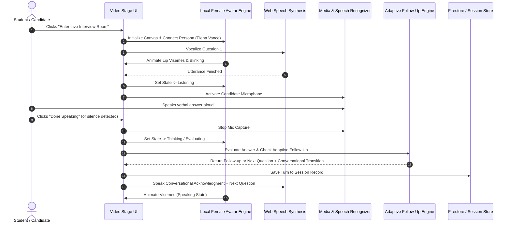

# Nexora InterviewAI — Interactive AI Interview Design

**Document ID:** `docs/INTERACTIVE_AI_INTERVIEW_DESIGN.md`  
**Version:** 2.0.0  
**Status:** Approved & Implemented  
**Date:** 18 October 2026  
**Audience:** Full-Stack Engineers, AI Systems Engineers, UI/UX Designers

---

## 1. Executive Summary & Core Architectural Pivot

### 1.1 The Problem with Legacy Voice-to-Text Mockups
The legacy mock interview design relied on an unengaging transcription-heavy user experience. When a candidate spoke, their voice was instantly converted to a chat bubble inside a scrolling text box, resembling an instant messaging window rather than a realistic technical or behavioral interview. This created three major UX and cognitive defects:
1. **Unnatural Interaction:** Candidates read text responses and typed manual inputs rather than engaging in authentic spoken dialogue.
2. **Lack of Non-Verbal Presence:** Static avatar images or flat text bubbles failed to convey interviewer attention, listening state, or active engagement.
3. **Cognitive Distraction:** Candidates focused on reading transcripts and correcting minor speech-to-text grammar errors rather than answering technical questions verbally.

### 1.2 The Immersive Studio Solution
In this redesign, Nexora InterviewAI transforms the interview interface into an **immersive, full-stage video meeting** (analogous to Google Meet, Zoom, or FaceTime):
- **Full-Stage Female AI Interviewer:** The female AI interviewer (Elena Vance or Dr. Sophia Chen) occupies the central stage with procedural facial visemes, natural eye-blinking, and synchronized speaking animation.
- **Auditory-First Interaction:** Questions and natural follow-up acknowledgments are vocalized aloud through the speech synthesis pipeline. The candidate responds naturally via microphone.
- **Accessibility & Subtitles:** Real-time closed captions (`[CC]`) float unobtrusively at the bottom of the video stage and can be toggled on or off by the candidate.
- **Private Transcript on Demand:** The full chronological transcript is relegated to a slide-out drawer (`[Transcript]`) for accessibility or candidate review, ensuring the primary UI remains 100% video-first.

---

## 2. Visual Architecture & Component Breakdown

```
+----------------------------------------------------------------------------------------------------+
|  [● LIVE INTERVIEW] Full Stack Engineer • TECHNICAL • Intermediate               04:22 [End Call]  |
+----------------------------------------------------------------------------------------------------+
|                                                                                                    |
|  [Elena Vance Tag]                    [Question 1 of 4 • Topic]                     [Candidate PiP |
|  Elena Vance • AI Sim                 "Explain hash collision resolution..."         You (Mic: 45%)|
|                                       [🎙️ Interviewer Speaking]                                    |
|                                                                                                    |
|                                                                                                    |
|                                         ################                                           |
|                                      ######################                                        |
|                                     ###  FEMALE AI AVATAR  ###                                     |
|                                     ###   (ELENA VANCE)    ###                                     |
|                                     ### Synchronized Viseme###                                     |
|                                      ######################                                        |
|                                                                                                    |
|                                                                                                    |
|                    [CC] Elena Vance: "Could you walk me through open addressing?"                  |
|                                                                                                    |
+----------------------------------------------------------------------------------------------------+
|         [🎙️ Mic]   [📹 Video]   [⏹️ Interrupt]   [🔁 Repeat]   [🚀 Done Speaking]   [CC]   [Notes]       |
+----------------------------------------------------------------------------------------------------+
```

### 2.1 Stage Layout Specifications
1. **Room Top Bar (`.roomTopBar`):**
   - Displays real-time session status badge (`LIVE INTERVIEW`), candidate target role, interview category, and difficulty level.
   - Live elapsed timer (`MM:SS`).
   - "Transcript / Notes" slide-out drawer toggle.
   - Distinct red "End Interview" control.

2. **Full-Stage Video Canvas (`.avatarCanvas`):**
   - Centered 16:9 canvas element (`720x480` logical resolution, responsive scale).
   - Driven by `LocalCanvasAvatarProvider` at 60 FPS.
   - Synchronized mouth visemes (mouth open/close ratio derived from syllable cadence).
   - Realistic blink cycles (intervals of 3.2s to 5.4s) and organic head sway.

3. **Floating Question & Turn Status Banner (`.stageQuestionBanner`):**
   - Glassmorphic overlay anchored at top-center.
   - Displays question number (`Question 1 of 4`), topic badge, and active question text.
   - Dynamic turn status pill:
     - `Interviewer Speaking` (pulsing blue radio wave)
     - `Listening to You` (emerald microphone indicator)
     - `Evaluating Answer` (purple spinning indicator)

4. **Interviewer Persona Overlay Tag (`.interviewerOverlayTag`):**
   - Positioned at top-left of stage.
   - Displays initials badge, persona name (e.g., `Elena Vance`), professional title (`Senior Systems Architect`), and an explicit disclaimer tag: `AI Simulation`.

5. **Candidate Picture-in-Picture (`.pipStudentCam`):**
   - Anchored at top-right corner.
   - Displays local webcam video (mirrored for natural eye contact).
   - Displays real-time RMS microphone input meter (green audio level bar, 0–100%).
   - Displays candidate name and mute/unmute status.

6. **Floating Closed Captions Overlay (`.closedCaptionsBox`):**
   - Anchored at bottom-center of stage.
   - Accessible via keyboard and mouse (`[CC]` button).
   - Displays speaker attribution (`Elena Vance:` or `You:`) and active dialogue without obscuring the avatar's face.

7. **Floating Meeting Control Bar (`.controlBar`):**
   - Anchored at bottom center.
   - **Microphone:** Toggle hardware mute/unmute.
   - **Camera:** Toggle hardware track pause/resume.
   - **Interrupt:** Stop avatar speech immediately and transition to listening state when candidate interjects.
   - **Repeat:** Re-vocalize active question.
   - **Done Speaking / Next:** Primary call-to-action with animated pulsing glow when candidate speech is detected.
   - **[CC] Captions:** Toggle subtitle visibility.

8. **Slide-Out Transcript Drawer (`.transcriptDrawer`):**
   - Hidden by default.
   - Slides smoothly from right margin when toggled.
   - Displays chronological question-and-answer audit log.
   - Includes accessibility text-typing input form for candidates unable to use microphone.

---

## 3. Conversational Interaction Flow



---

## 4. Accessibility and Ethical Transparency

### 4.1 AI-Generated Disclosure
As mandated by AI transparency standards, the interface clearly tags all personas:
- Top-left badge: `Elena Vance • Senior Systems Architect • AI Simulation`.
- Pre-flight diagnostic screen disclaimer: *"This interview is conducted by an AI interviewer simulation designed for technical skill development."*
- Evaluation reports explicitly distinguish between algorithmic test evaluations and qualitative AI-generated suggestions.

### 4.2 Candidate Inclusivity
- **Closed Captions (`[CC]`):** Provides high-contrast, readable subtitles for hearing-impaired candidates or noisy environments.
- **Manual Input Fallback:** For candidates with microphone hardware limitations, the transcript drawer allows direct text submission without failing the session.
- **Interrupt Capability:** Candidates can pause or interrupt interviewer speech at any time without software lockups.
