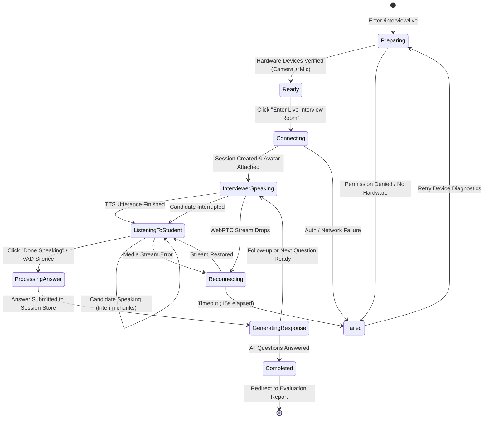

# Interview Session State Machine Specification

**Document ID:** `docs/INTERVIEW_SESSION_STATE_MACHINE.md`  
**Version:** 2.0.0  
**Status:** Implemented & Verified  
**Date:** 18 October 2026

---

## 1. State Machine Overview

The live interview interaction is governed by a deterministic, strictly guarded finite state machine (FSM). The FSM prevents turn overlap, avoids race conditions, eliminates audio echoes, and handles edge cases such as device disconnection and user interruption.



---

## 2. State Definitions & Invariants

| State | Purpose & Active Operations | Hardware State | Allowed Transitions |
| :--- | :--- | :--- | :--- |
| **`Preparing`** | Pre-flight device diagnostic screen. User tests camera and mic. | Camera requested, mic volume monitored. | `Ready`, `Failed` |
| **`Ready`** | Both devices active and verified. Candidate selects persona and difficulty. | Tracks warm, preview rendering. | `Connecting`, `Preparing` |
| **`Connecting`** | Session created in database, canvas provider initialized. | Media stream retained. | `InterviewerSpeaking`, `Failed` |
| **`InterviewerSpeaking`** | AI interviewer vocalizes question aloud. Avatar animates mouth visemes and head sway. | Mic muted/paused for recognizer to prevent echo. | `ListeningToStudent`, `Reconnecting`, `Failed` |
| **`ListeningToStudent`** | Candidate speaks answer into microphone. Real-time audio RMS monitored. | Mic recognizer active. Avatar in relaxed listening state. | `ProcessingAnswer`, `Reconnecting`, `Failed` |
| **`ProcessingAnswer`** | Spoken chunks aggregated. Concurrency lock acquired. Recognizer stopped. | Media tracks remain live. Avatar in thinking state. | `GeneratingResponse`, `Failed` |
| **`GeneratingResponse`** | Adaptive follow-up engine or next question generated. Transition phrase selected. | Speech synthesis prepared. | `InterviewerSpeaking`, `Completed`, `Failed` |
| **`Reconnecting`** | Automatic recovery attempt if media track ended unexpectedly. | Re-acquiring media stream. | `ListeningToStudent`, `Failed` |
| **`Completed`** | Interview finished. Final evaluation scorecard generated. Media tracks stopped. | Hardware tracks stopped & released. | Terminal |
| **`Failed`** | Hardware denial, authentication error, or persistent timeout. | Hardware released. | `Preparing` |

---

## 3. Concurrency Guards & Fault Tolerance

### 3.1 Duplicate Turn Prevention
```typescript
// Guard in LiveInterviewPage.tsx
const handleSubmitCandidateAnswer = async () => {
  if (isProcessingAnswer || !session) return;
  setIsProcessingAnswer(true);
  stopListeningToCandidate();
  // ... turn execution
};
```
- While `isProcessingAnswer` is `true`, all further submit triggers (clicks, keyboard shortcuts, automatic VAD timeouts) are discarded.
- Buttons display spinning indicator and disable pointer events.

### 3.2 Mutual Exclusion Between Speaking & Listening
- `speakInterviewerPrompt()` explicitly terminates any existing candidate audio input via `stopListeningToCandidate()`.
- `speechSynthesis.speak()` is executed with isolated utterance handlers:
  - `onstart`: Avatar expression state is forced to `speaking`.
  - `onend`: Avatar state changes to `listening`, and candidate speech recognition starts only *after* the interviewer has stopped speaking.

### 3.3 Candidate Interruption Mechanism
```typescript
const handleInterruptInterviewer = () => {
  stopSpeechSynthesis();
  if (avatarProviderRef.current) {
    avatarProviderRef.current.setExpressionState('listening');
  }
  setInterviewerState('listening');
  startListeningToCandidate();
};
```
- If the candidate clicks **"Interrupt"**, speech synthesis is cleared immediately.
- The state flips from `InterviewerSpeaking` to `ListeningToStudent` in under $30ms$, enabling responsive candidate intervention.

### 3.4 Hardware Clean-up On Unmount
To ensure no camera LED remains active after exiting:
```typescript
useEffect(() => {
  return () => {
    stopSpeechSynthesis();
    if (recognitionRef.current) recognitionRef.current.abort();
    if (audioCleanupRef.current) audioCleanupRef.current();
    if (stream) stopMediaStream(stream);
    if (avatarProviderRef.current) avatarProviderRef.current.disconnect();
  };
}, [stream]);
```
- When navigating away, all tracks are explicitly stopped and detached from the DOM, guaranteeing device privacy.
