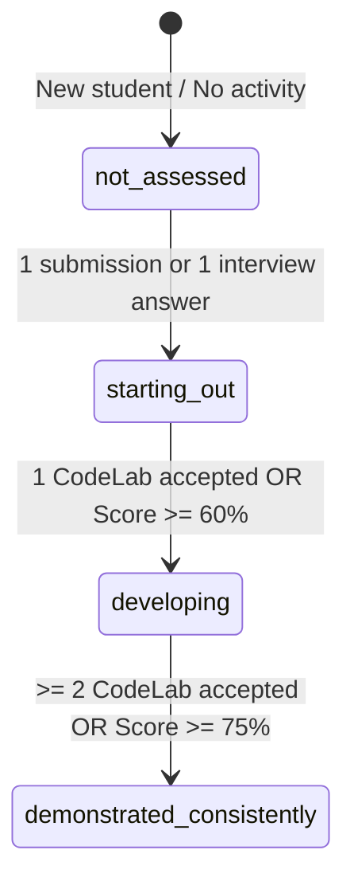

# Nexora Learning Analytics & Confidence Model

## 1. Core Principles

The Nexora Learning Analytics Engine transforms verified student activity into transparent, explainable skill profiles. It enforces five essential constraints:

1. **No Fabricated Data**: Metrics are calculated solely from verified, persisted database records.
2. **Separation of Evidence Types**: Objective code execution verdicts (CodeLab) and AI rubric evaluations (InterviewAI) are tracked separately and never collapsed into an opaque single score.
3. **Evidence Distinction**:
   - **Activity**: The student initiated or submitted an attempt.
   - **Completion**: The student completed all test suites or finished an interview session.
   - **Performance**: The score, runtime, or test pass percentage of a specific attempt.
   - **Confidence State**: A cautious qualitative tier indicating whether evidence is sufficient to justify competence.
4. **Offline Resilience & Caching**: Bounded queries, in-memory aggregation, and local caching prevent continuous expensive database recalculations.
5. **Deterministic Rules**: No opaque neural net or black-box model is used to guess student aptitude.

---

## 2. Confidence State Machine

Confidence states represent how much verified evidence exists for each skill. Nexora utilizes a 4-tier model:

### State Definitions

| State | Label in UI | Accessible Description | Underlying Data Criteria |
| :--- | :--- | :--- | :--- |
| `not_assessed` | **Not Assessed** | "No verified activities completed yet" | 0 CodeLab attempts AND 0 Interview answers recorded for this skill. |
| `starting_out` | **Starting Out** | "Initial practice recorded, more evidence needed" | 1 attempt recorded, but problem not yet accepted OR interview score < 60%. |
| `developing` | **Developing** | "Demonstrating competency across foundational tasks" | 1 accepted CodeLab problem OR interview average score between 60% and 74%. |
| `demonstrated_consistently` | **Demonstrated Consistently** | "Strong, repeated verified mastery across tasks" | >= 2 distinct accepted CodeLab problems OR interview average score >= 75%. |

---

## 3. Evidence Ingestion & Verification

### CodeLab Evidence
- **Only Accepted Verdicts Count as Solved**: Submissions with status `error`, `runtime_error`, `wrong_answer`, or `time_limit_exceeded` are tallied under attempts, but **never** count toward `problemsSolved`.
- **Duplicate Prevention**: If a student submits the same accepted problem 5 times, it counts as 1 distinct solved problem toward mastery and milestone progress.
- **Mock Exclusion**: Synthetic mock runs (`isMockExecution: true`) or unsaved playground trials are explicitly excluded from student mastery evidence.

### InterviewAI Evidence
- **Only Completed Sessions Count**: Abandoned or initialized sessions do not contribute to `averageInterviewScore` or answered questions.
- **Rubric-Driven Evaluation**: Scores are derived from structured rubrics across:
  - Technical Accuracy (0–100)
  - Reasoning & Edge Cases (0–100)
  - Communication Structure (0–100)
- **Scores Kept Dimensioned**: Communication scores update `int-star-communication`; technical correctness updates `int-concept-articulation`.

---

## 4. Aggregate Formulae

### CodeLab Acceptance Ratio
$$\text{Pass Rate} = \frac{\text{Accepted Problems}}{\text{Total Submissions}} \times 100$$

### Composite Interview Score
$$\text{Average Score} = \frac{\sum_{i=1}^{N} \text{Session Score}_i}{N}$$
*(Null if $N = 0$, explicitly rendered as "Not Assessed" rather than "0%" to avoid misleading penalty displays).*

### Learning Path Completion
$$\text{Path Progress \%} = \text{round}\left(\frac{\text{Completed Milestones}}{\text{Total Milestones in Path}} \times 100\right)$$

---

## 5. Chronological Unified Activity Feed

The analytics engine aggregates recent events into a unified timeline:
- **CodeLab Submissions**: Timestamp, problem title, verdict badge, language, runtime, passed tests.
- **InterviewAI Sessions**: Timestamp, session role/category, evaluated score, question count.
- Sorted deterministically descending (`timestamp` newest first).
- Capped at 20 most recent events for optimal payload size and fast client rendering.
