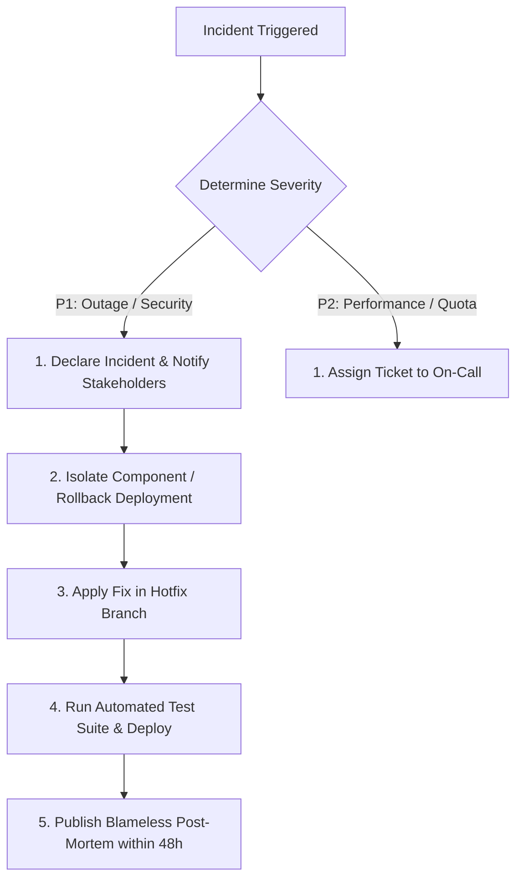

# Nexora Platform: Monitoring, Logging & Incident Response Runbook

> **Target Systems:** Nexora CodeLab + Nexora InterviewAI  
> **Status:** Operational Runbook & Logging Specification  

---

## 1. Logging Principles & Safe Diagnostic Standards

Logging must provide operational visibility without creating data leakage risks:
- **Zero Sensitive Content**: Passwords, auth tokens, candidate source code, full interview transcripts, and private test case assertions are **strictly prohibited** from application logs.
- **Safe Diagnostic Fields**:
  - Timestamp (ISO 8601 UTC).
  - Event name (e.g. `EXECUTION_REQUEST`, `INTERVIEW_SESSION_CREATED`).
  - Anonymized / Hashed User ID (`userId`).
  - Problem Slug / Interview Category.
  - Operation type (`run` vs `submit`).
  - Execution duration (ms) and HTTP status code.
  - Error Code (e.g. `resource-exhausted`, `unauthenticated`, `permission-denied`).

### Log Severity Hierarchy

| Level | Usage in Codebase | Example Scenarios |
| :--- | :--- | :--- |
| `DEBUG` | Local development tracing only | Local cache hit/miss, component mount lifecycle. |
| `INFO` | High-level operational events | User logged in, submission processed, interview evaluated. |
| `WARN` | Recoverable or graceful degradation | Offline emulator fallback, draft storage quota reached, missing App Check site key. |
| `ERROR` | Operation failure requiring inspection | Cloud Function unhandled exception, Firestore permission denial, upstream Judge0 timeout. |
| `CRITICAL` | Systemic failure or security trigger | Auth flood detected, persistent 5xx outage, database connectivity loss. |

---

## 2. Cloud Monitoring & Alert Thresholds

The following alert conditions should be configured in **Google Cloud Monitoring** once staging and production infrastructure is provisioned:

| Alert ID | Target Metric | Trigger Condition | Severity | Escalation Path |
| :--- | :--- | :--- | :--- | :--- |
| `ALERT-01` | Cloud Functions 5xx Rate | > 3% error rate for 5 consecutive minutes | P1 | On-Call Engineer (Slack/PagerDuty webhook) |
| `ALERT-02` | Sandbox / AI Latency | p95 latency > 8,000 ms for 10 minutes | P2 | Systems Engineer; check upstream provider health |
| `ALERT-03` | Firestore Permission Denials | > 20 `PERMISSION_DENIED` errors / min | P1 | Security Lead; inspect for active exploitation attempt |
| `ALERT-04` | Auth Failures | > 50 failed logins / min from single IP | P2 | Automated Cloud Armor IP ban trigger |
| `ALERT-05` | Daily Budget Consumption | Monthly GCP spend exceeds 80% threshold | P1 | Financial / Engineering Lead alert |

---

## 3. Incident Triage & Response Procedures

### Scenario A: Credential or Secret Exposure
1. **Immediate Revocation**: Immediately revoke the exposed token or API key in the respective provider console (RapidAPI, Google AI Studio, GCP IAM).
2. **Key Rotation**: Generate a replacement credential and set it via Google Secret Manager / `firebase functions:secrets:set`.
3. **Audit Access Logs**: Inspect Cloud Logging and provider usage dashboards for anomalous requests during the exposure window.
4. **Purge Commit History**: If committed to Git, rewrite repository history using `git filter-repo` or BFG Repo-Cleaner before pushing.

### Scenario B: Upstream Provider Outage (Judge0 or Gemini)
1. **Status Verification**: Check official provider status pages (e.g. RapidAPI Status, Google Cloud Status).
2. **Circuit Breaker**: The application safely isolates failures: `executeCode` returns `internal_error` with a user-friendly status message rather than crashing the client.
3. **User Communication**: Enable an informational banner on the dashboard warning students of temporary third-party latency.

### Scenario C: Firestore Security Rule Breach Attempt
1. **Rule Audit**: Check Cloud Logging for rule evaluation denials (`request.auth.uid != resource.data.userId`).
2. **IP Isolation**: If systematic probe patterns are detected, add IP block in Cloud Armor security policy.
3. **Data Verification**: Verify database change streams (Firestore Audit Logs) to ensure no unauthorized document modifications occurred.

---

## 4. Post-Incident Review Standard

Every P1 or P2 incident requires a published blameless post-mortem within 48 hours documenting:
- Incident summary and customer impact duration.
- Exact root cause (code defect, infrastructure exhaustion, third-party dependency).
- Timeline of events (detection, triage, mitigation, resolution).
- What went well, what went poorly, where we got lucky.
- Preventative action items with assigned owners and target completion dates.
