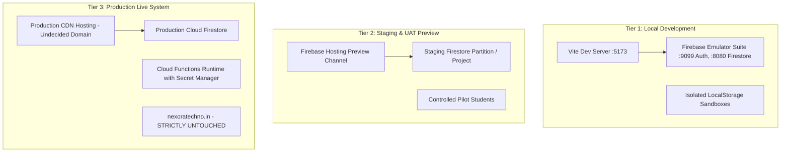

# Phase 10: Environment Strategy & Data Boundary Architecture

## 1. Environment Architecture Overview

To guarantee complete safety, prevent data contamination, and eliminate risk to existing production systems (`https://nexoratechno.in`), the Nexora platform adopts a 3-tier isolated environment architecture.



---

## 2. Environment Configuration Matrix

| Configuration Variable | Local Development | Staging / Preview | Production (Post-Approval) | Access Boundary |
| :--- | :--- | :--- | :--- | :--- |
| `VITE_APP_ENV` | `development` | `staging` | `production` | Public client bundle |
| `VITE_USE_FIREBASE_EMULATORS` | `true` (optional) | `false` | `false` | Public client bundle |
| `VITE_FIREBASE_PROJECT_ID` | `nexoratechno-code` | `nexoratechno-code` | `nexoratechno-code` (or approved prod) | Public client bundle |
| `VITE_FIREBASE_AUTH_DOMAIN` | `localhost:9099` (if emu) | Dedicated Preview Channel | Dedicated Custom Domain | Public client bundle |
| `JUDGE0_API_KEY` | None (Local Sandbox) | Staging Secret Manager | Production Secret Manager | **Server-side secret ONLY** |
| `AI_PROVIDER_API_KEY` | None (Deterministic Fallback) | Staging Secret Manager | Production Secret Manager | **Server-side secret ONLY** |

---

## 3. Data Isolation & Boundary Enforcement

1. **Strict Client-Side Credential Protection**:
   No third-party API keys (Judge0, OpenAI, Anthropic, Gemini) are ever included in frontend source code, environment files (`.env`), or bundled JavaScript chunks. All sensitive provider interactions must pass through authenticated Firebase Cloud Functions.

2. **No Contamination with Existing Website**:
   The existing company marketing website (`https://nexoratechno.in`) operates on a separate infrastructure and hosting stack. The new Nexora web application must not modify existing DNS A-records, CNAMEs, or hosting configs without explicit authorization.

3. **Staging Preview Channels**:
   Staging releases utilize Firebase Hosting Preview Channels:
   ```bash
   firebase hosting:channel:deploy staging-uat-preview
   ```
   This generates a secure, ephemeral HTTPS URL accessible only to authorized pilot testers and reviewers without altering live production traffic.

4. **Firestore Rules Enforcement Across Environments**:
   `firestore.rules` are tested and verified identically across local emulators, staging, and production to guarantee no environment-specific security loopholes.

---

## 4. Outstanding Owner Decisions

1. **Production Domain Selection**: Confirm whether Nexora will launch on a subdomain (e.g. `app.nexoratechno.in` or `learn.nexoratechno.in`) or a dedicated domain name.
2. **Firebase Blaze Plan Billing**: Provide explicit authorization before upgrading the Firebase project to enable Cloud Functions deployment and outbound networking.
