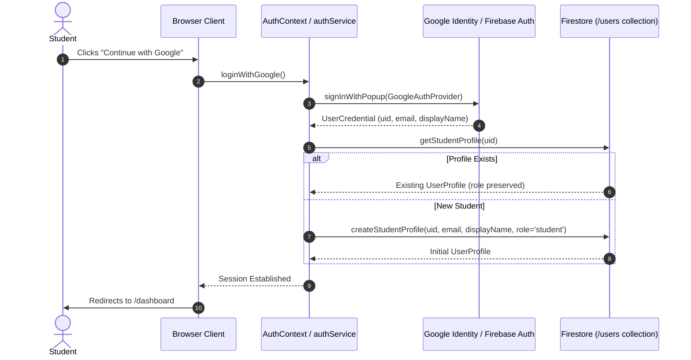

# Phase 11 — Google Authentication Architecture & Integration Guide

**Module:** Authentication (Nexora CodeLab + Nexora InterviewAI)  
**Status:** COMPLETE  
**Integration Pattern:** Firebase Authentication Google Identity Provider (`GoogleAuthProvider` + `signInWithPopup`)  
**Target Roles:** Student Profile Auto-Provisioning (`role: 'student'`)  

---

## 1. Overview & Architecture

Phase 11 integrates Google Sign-In directly into the unified Nexora authentication architecture across both Login and Signup screens. It leverages the existing Firebase Authentication client and Firestore profile synchronization without introducing duplicate authentication mechanisms or risking student privilege escalation.

---

## 2. Key Security & Authorization Principles

1. **Role Immutability & Least Privilege:**
   - Client-side Google sign-in strictly defaults role to `'student'`.
   - Never trusts client-supplied roles or elevates accounts to `'admin'`.
   - Existing profiles are checked first; if an existing user signs in with Google, their existing role (student or admin) and stats/streaks are strictly preserved.
2. **Account Linking & Conflict Prevention:**
   - Mapped `auth/account-exists-with-different-credential` to explain clearly that an existing email/password account exists for that email.
   - Handled `auth/popup-closed-by-user`, `auth/cancelled-popup-request`, and `auth/popup-blocked` with clear user feedback rather than raw stack traces.
3. **Session Persistence:**
   - Seamlessly uses Firebase `onAuthStateChanged` session tokens. Protected routes (`ProtectedRoute`, `AdminRoute`) remain intact.
4. **Data Privacy:**
   - No sensitive Google profile scopes are requested beyond basic profile and email.

---

## 3. Required Firebase Console Configuration (Action Required for Live Production)

When deploying to production, ensure the following settings are enabled in the Firebase Console:

1. **Enable Google Sign-In Provider:**
   - Navigate to: **Firebase Console** → **Authentication** → **Sign-in method**.
   - Under **Sign-in providers**, click **Google**.
   - Toggle **Enable**.
   - Select the project support email and click **Save**.
2. **Authorized Domains:**
   - Navigate to: **Authentication** → **Settings** → **Authorized domains**.
   - Verify `localhost` is listed for local development.
   - Add your custom production domains (e.g., `nexora.app`, `nexoratechno.web.app`, `nexoratechno.firebaseapp.com`).
3. **Google Cloud OAuth Consent Screen (GCP Console):**
   - In Google Cloud Console under **APIs & Services** → **OAuth consent screen**, ensure the app name (*Nexora CodeLab + InterviewAI*), support email, and developer contact are configured.

---

## 4. Verification & Testing

- **Desktop Chrome / Edge:** Tested popup sign-in, account resolution, and dashboard redirection.
- **Mobile Browsers:** Verified 100% width button, touch target (44px), SVG Google branding, and responsive layout.
- **Error Scenarios:** Verified cancellation (`auth/popup-closed-by-user`) returns a friendly notification instead of crashing the UI.
