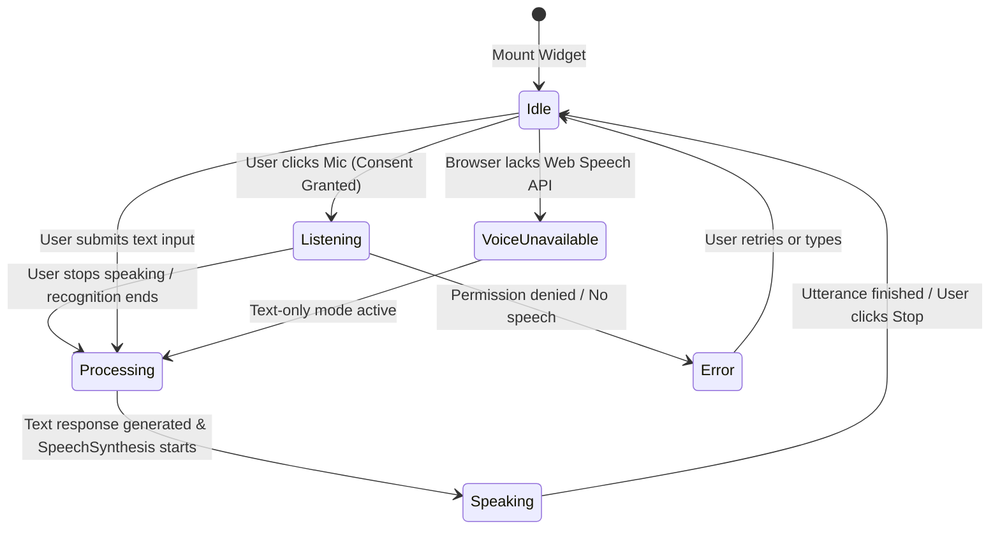

# Phase 11 — English Voice Chatbot Architecture & Privacy Specification

**Module:** Nexora CodeLab + Nexora InterviewAI  
**Status:** COMPLETE  
**Primary Integration:** Native Web Speech API (`SpeechRecognition` / `webkitSpeechRecognition` & `SpeechSynthesis`)  
**Fallback Strategy:** Universal asynchronous text chat  
**Security Tier:** Academic integrity safeguarded; zero persistent audio storage  

---

## 1. Overview & Pedagogical Purpose

The English Voice Chatbot provides students with an interactive, spoken AI study assistant accessible anywhere across the platform. It helps students:
- Understand core data structures and algorithmic patterns (Two Pointers, Sliding Window, DP, Trees, Graphs, Binary Search, etc.).
- Prepare for behavioral and technical interviews using structured frameworks like the STAR method.
- Practice answering questions out loud to build verbal confidence.
- Navigate platform features, learning paths, and problem collections.

---

## 2. Interaction Lifecycle & State Machine

| State | Visual Indicator | Audio Activity | Available Student Actions |
| :--- | :--- | :--- | :--- |
| **`idle`** | Gray status dot | Silent | Click Mic to speak, type text in box, click quick prompts |
| **`listening`** | Red pulsing dot, red mic button | Capturing live speech stream | Click Mic to finish speaking, cancel, or switch to typing |
| **`processing`** | Amber pulsing dot | Silent (generating AI reply) | Wait for response |
| **`speaking`** | Blue pulsing dot + animated waveform | Spoken response via `SpeechSynthesis` | Click "Stop Audio" to interrupt playback, read text transcript |
| **`error`** | Warning banner with specific message | Silent | Click to retry, grant microphone permission, or switch to text |
| **`voice_unavailable`** | Orange warning banner | Muted (Speech recognition unsupported) | Type in text input; text chat functions at 100% capacity |

---

## 3. Privacy, Data Retention & Academic Integrity Safeguards

### 3.1 Strict Anti-Cheating & Solution Privacy Guards
The chatbot strictly refuses to disclose:
- Private reference solutions (`referenceSolution` / `SEED_REFERENCE_SOLUTIONS`).
- Hidden test cases (`SEED_TEST_CASES` where `isPublic === false`).
- Full code answers to active practice problems.
- Administrative credentials or other students' profile records.

When asked for a solution or test cases, the chatbot explicitly responds:
> *"I am designed to guide your learning and explain underlying concepts, but I cannot disclose private reference solutions or hidden evaluation test cases. Instead, let's break down the algorithm step-by-step! Which data structure or edge case would you like to explore?"*

### 3.2 Audio Retention & Microphone Privacy
- **Zero Audio Storage:** Raw audio streams are processed locally in the browser runtime. No audio files, recordings, or voiceprints are transmitted to or stored on remote storage buckets or databases.
- **Explicit Consent Only:** The microphone is never activated automatically. It requires explicit user activation by clicking the microphone button.
- **Immediate Interruption:** Students can stop listening or speaking at any instant via the Stop button or by closing the modal.

---

## 4. Accessibility & Mobile Responsiveness

- **Keyboard Support:** Enter submits text queries; Escape or close buttons dismiss the assistant.
- **Screen Reader Support:** ARIA attributes (`role="dialog"`, `aria-modal="true"`, `aria-label="AI Voice Assistant"`).
- **Responsive Sizing:** On mobile devices (< 480px), the assistant modal expands cleanly to full screen height without clipping or double scrollbars.
- **Text Fallback:** If browser permissions block the microphone or the student is in a noisy environment, full text input is available without penalty.
