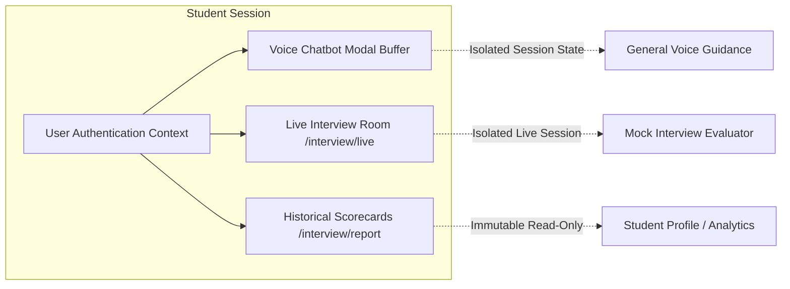

# PHASE 12 — CONVERSATION CONTEXT & SESSION MEMORY ISOLATION

**Product:** CodeXpertai (Nexora CodeLab + Nexora InterviewAI)  
**Standard:** Context Isolation, State Privacy & Session Boundaries  
**Status:** IMPLEMENTED & DOCUMENTED

---

## 1. Overview & Isolation Architecture

To ensure conversational accuracy, student privacy, and seamless multi-turn experiences, CodeXpertai enforces strict isolation boundaries across:
1. **General AI Study Coach (Voice Chatbot)**
2. **One-on-One Live Video Mock Interview Sessions**
3. **Historical Interview Evaluations & Scorecards**

Data, transcript logs, and conversation state from one context never leak into another.

---

## 2. Conversation State Separation

Within every conversational interface, distinct state variables govern each stage of turn-taking:

| State Variable | Scope & Responsibility | Protection Mechanism |
| :--- | :--- | :--- |
| `currentInputText` | The transient, unsent text typed or transcribed from microphone speech. | Wiped immediately upon submission to prevent double-submit. |
| `activeSessionHistory` | The array of prior `ChatMessage[]` turns within the active session. | Scoped to the local modal / interview room lifecycle; isolated per session ID. |
| `generatingAssistantId` | Pointer to the assistant message currently undergoing AI response generation. | Processing lock prevents concurrent query dispatch. |
| `activeSpeakingMsgId` | Pointer to the single message currently being spoken via Web Speech Synthesis. | Speech synthesis lock (`spokenMessageIds.has(id)`) ensures each message is spoken **at most once**. |
| `replayRequested` | Flag indicating explicit student intent to replay a previous answer. | Cleared immediately after speech utterance begins. |

---

## 3. Cross-Session & Cross-User Privacy Guardrails

1. **No Shared Inter-User State:**
   Conversations are tied directly to the authenticated `user.uid`. Guest or unauthenticated attempts are blocked from accessing private interview rooms.
2. **No Leaking Between Chatbot and Interview Sessions:**
   The voice chatbot operates in its own memory space for general technical study and platform navigation. It cannot access live mock interview transcripts, nor can the mock interviewer be prompted to retrieve voice chatbot history.
3. **Session Reset on Close:**
   When the voice chatbot modal or live interview room is exited, the active session buffer is safely cleared or committed to Firestore, and media hardware tracks are destroyed.
4. **Context Window Management:**
   When sending context history to the AI reasoning engine, history is bounded to the recent relevant turns (sliding window of the last 6–10 turns) to prevent token bloat while retaining high conversational relevance.
