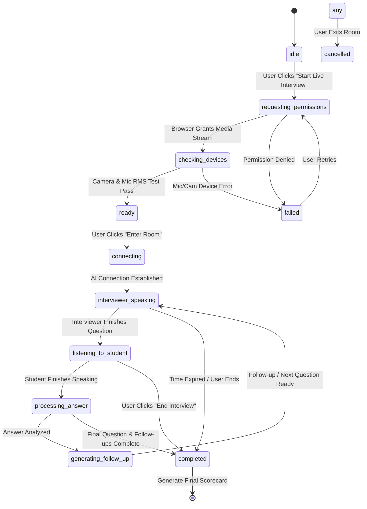

# PHASE 12 — INTERVIEW SESSION LIFECYCLE & STATE MACHINE SPECIFICATION

**Product:** CodeXpertai (Nexora CodeLab + Nexora InterviewAI)  
**Module:** Live AI Interview Room (`/interview/live`)  
**Standard:** Deterministic Finite State Machine (FSM)  
**Status:** IMPLEMENTED & DOCUMENTED

---

## 1. State Machine Definition

To eliminate race conditions, duplicate submissions, hanging audio, and overlapping speech playback, the Live Interview room transitions through a strictly governed finite state machine:

---

## 2. States and Invariants

| State | Purpose | User Action Allowed | Media Track Status |
| :--- | :--- | :--- | :--- |
| `idle` | Initial setup screen on `/interview/setup`. | Edit configuration, toggle track, pick persona. | Inactive. |
| `requesting_permissions` | Prompts browser for camera and microphone access. | Click browser permission prompt. | Initializing. |
| `checking_devices` | Validates live video stream and calculates microphone audio RMS. | Speak into mic, verify video box. | Active (local preview only). |
| `ready` | Media passed health checks; waiting for student to enter. | Click "Enter Live Interview Room". | Active. |
| `connecting` | Instantiates session, loads question catalog, initializes avatar engine. | View connecting spinner. | Active. |
| `interviewer_speaking` | Female AI interviewer vocalizes question with synchronized facial lip sync. | Interrupt/Repeat question, mute mic. | Active (Interviewer TTS playing). |
| `listening_to_student` | Microphone transcribes student answer in real time; tracks silence timer. | Speak answer, type edits, click "Done Speaking". | Active (Student mic transcribing). |
| `processing_answer` | Analyzes answer content against question rubric and extracts concepts. | View processing animation. | Active (Muted). |
| `generating_follow_up` | Dynamically creates contextual follow-up question referencing answer. | View thinking animation. | Active. |
| `completed` | Concludes interview, releases all media hardware, generates evaluation report. | View evaluation scorecard and review answers. | Stopped & Released. |
| `failed` | Surfaced when permission is denied or hardware fails. | Read error message, click "Retry Check". | Stopped. |
| `cancelled` | Student explicitly exits or navigates away. | Return to dashboard or interview setup. | Stopped & Released. |

---

## 3. Resilience & Edge-Case Handling

1. **Browser Tab Close or Page Navigation:**
   A `beforeunload` and React cleanup effect strictly executes `stream.getTracks().forEach(t => t.stop())` and `window.speechSynthesis.cancel()`. Hardware camera/mic lights turn off immediately.
2. **Device Hardware Disconnection:**
   If a user unplugs their USB microphone mid-interview, `track.onended` pauses the session timer and displays a reconnection modal rather than crashing.
3. **Overlapping Requests:**
   Submission buttons and SpeechRecognition `onend` triggers are gated behind an `isProcessing` mutex, preventing duplicate answer submissions or double credit deductions.
4. **Offline / Network Interruption:**
   In-progress answers and transcripts are continuously cached in local storage buffer (`nexora_live_interview_session`), enabling instant recovery upon page reload without loss of previous answers.
