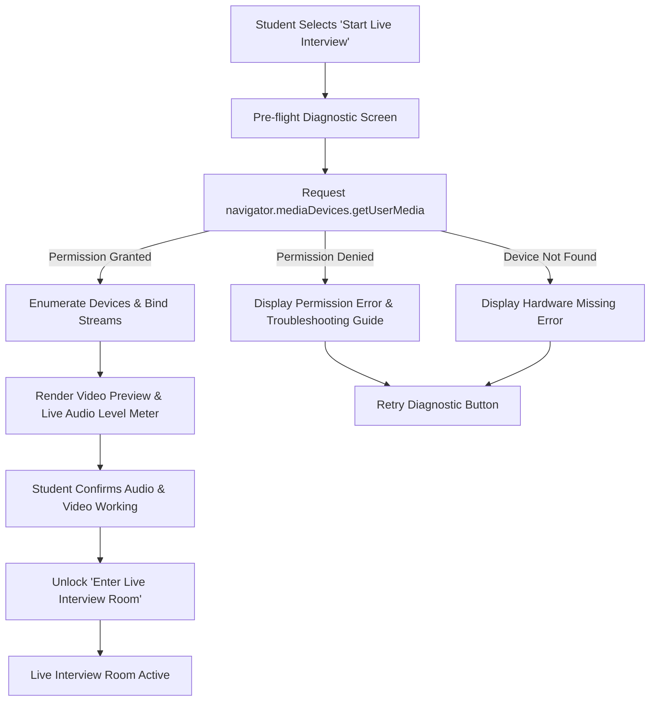

# PHASE 12 — CAMERA AND MICROPHONE PERMISSION & MEDIA LIFECYCLE SPECIFICATION

**Product:** CodeXpertai (Nexora CodeLab + Nexora InterviewAI)  
**Module:** Live One-on-One AI Interview Room (`/interview/live`)  
**Standard:** WebRTC MediaStream, MediaDevices API & W3C Permissions API  
**Status:** IMPLEMENTED & DOCUMENTED

---

## 1. Overview & Security Principles

Live technical mock interviews require active participation via spoken verbal communication and live visual presence. CodeXpertai enforces a strict, transparent media lifecycle adhering to browser security models and user privacy principles:

1. **No Silent Media Access:** Media devices (`getUserMedia`) are never queried in the background without explicit user intent.
2. **Pre-flight Readiness Verification:** Live interview sessions are strictly prevented from initiating until both camera and microphone devices are verified active and functional.
3. **No Hidden Cloud Media Recording:** Video and audio streams are processed exclusively within the local browser execution context for rendering and live speech-to-text. Raw audio and video are not secretly streamed or persisted to remote servers without explicit disclosure and authorization.
4. **Guaranteed Media Release:** When the interview concludes, is cancelled, or the user navigates away, all hardware tracks (`MediaStreamTrack.stop()`) are immediately terminated to release the camera and microphone hardware indicators.

---

## 2. Pre-flight Device Verification Flow



### Step-by-Step Flow:
1. **Initiation:** The student chooses their interview track, difficulty tier, and female interviewer persona (Elena Vance or Dr. Sophia Chen) on `/interview/setup`, then clicks **Start Live One-on-One Interview**.
2. **Permission Request:** The application triggers `navigator.mediaDevices.getUserMedia({ video: { width: 1280, height: 720 }, audio: true })`.
3. **Hardware Assessment:**
   - Detects video tracks (`stream.getVideoTracks()`) and audio tracks (`stream.getAudioTracks()`).
   - Hooks an `AudioContext` and `AnalyserNode` to compute the real-time RMS microphone input volume (0–100%) to verify that sound waves are actively registering.
4. **Live Preview Confirmation:**
   - Displays a mirrored video feed in a secure `<video autoPlay playsInline muted />` element.
   - Displays an animated audio level meter that reacts to the student's voice.
   - Shows device labels (e.g. *Integrated Camera*, *Microphone Array*).
5. **Gated Room Entry:**
   - The "Enter Live Interview Room" button remains disabled until both camera and microphone pass operational health checks.

---

## 3. Failure & Exception Handling Matrix

| Error Condition | Browser Exception | User-Facing Explanation | Remediation Action |
| :--- | :--- | :--- | :--- |
| **Permission Denied** | `NotAllowedError` or `PermissionDeniedError` | *"Camera or microphone access was blocked by your browser settings."* | Provides step-by-step guidance on clicking the browser lock/media icon in the address bar to set permissions to 'Allow', then presents a **Retry Device Check** button. |
| **Device Missing** | `NotFoundError` or `DevicesNotFoundError` | *"No camera or microphone was detected on this computer or device."* | Instructs the user to verify hardware connection (USB webcam/headset) and click **Retry**. |
| **Device in Use** | `NotReadableError` or `TrackStartError` | *"Camera or microphone is already in use by another application (e.g. Zoom, Teams, Meet)."* | Instructs user to close competing video software and click **Retry**. |
| **Unsupported Browser** | `TypeError` or absence of `mediaDevices` | *"Your browser does not support WebRTC media capture."* | Recommends switching to modern Google Chrome, Microsoft Edge, Brave, or Safari, and offers text-only interview fallback. |

---

## 4. In-Session Device Monitoring & Lifecycle

### Status Indicators
During the live interview session, the interface maintains visible hardware status badges:
- **Camera Active Indicator:** Green badge `Camera Live` with real-time video feed in the user's picture-in-picture box.
- **Microphone Active Indicator:** Green pulse badge `Mic Active` with real-time volume activity bars.
- **Mute / Unmute Controls:** Instant audio and video pause controls allowing the student to momentarily mute their microphone or disable video if needed.

### Device Disconnection & Track Loss
If an external headset or webcam is physically unplugged during the session:
- The `track.onended` listener triggers immediately.
- The UI transitions into a warning state: `Device Interrupted — Please reconnect microphone or camera`.
- The interview clock and turn state pause safely until the connection is restored or the student terminates the session.

### Complete Hardware Termination on Exit
When the interview ends (either normally through completion or via the **End Interview** button):
```typescript
export function stopMediaStream(stream: MediaStream | null): void {
  if (!stream) return;
  stream.getTracks().forEach((track) => {
    track.stop();
    track.enabled = false;
  });
}
```
All audio analysis contexts are closed, camera streams unmounted, speech synthesis cancelled, and speech recognition aborted.
