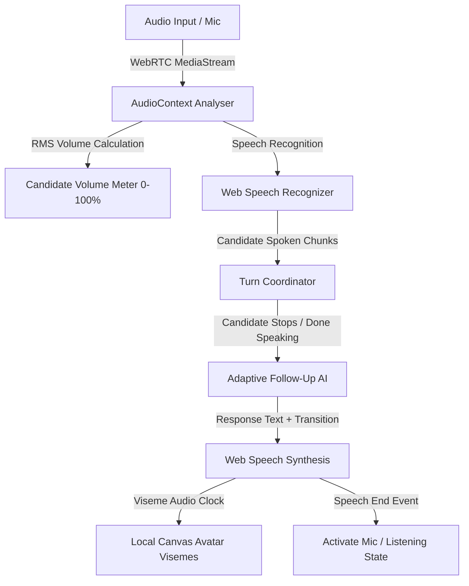

# Real-Time Audio & Avatar Integration Architecture

**Document ID:** `docs/REALTIME_AUDIO_AND_AVATAR_INTEGRATION.md`  
**Version:** 2.0.0  
**Status:** Implemented & Verified  
**Date:** 18 October 2026

---

## 1. Overview & Architecture Strategy

The Nexora InterviewAI real-time media architecture decouples avatar rendering and audio processing from specific external cloud vendors using the **Avatar Provider Adapter Pattern**. This ensures the platform can operate with zero external API fees and zero latency out of the box while supporting cloud WebRTC streaming avatars whenever API credentials are provided.

```
                      +-----------------------------------+
                      |      LiveInterviewPage (Host)     |
                      +-----------------+-----------------+
                                        |
                 +----------------------+----------------------+
                 |                                             |
  +--------------v---------------+             +---------------v--------------+
  |    LocalCanvasAvatarProvider |             | CloudStreamingAvatarProvider |
  |   (Zero Cost / Zero Latency) |             |    (WebRTC / HeyGen / D-ID)  |
  +--------------+---------------+             +---------------+--------------+
                 |                                             |
   Procedural 60 FPS Canvas Engine                External WebRTC Remote Stream
   Mouth Visemes & Eye Blink Loop                 STATUS: BLOCKED_ON_CREDENTIALS
```

---

## 2. Avatar Provider Adapter Interface

The core provider contract is defined in `src/services/avatarProviderService.ts`:

```typescript
export type AvatarState = 'idle' | 'speaking' | 'listening' | 'thinking' | 'reconnecting';

export interface IAvatarProvider {
  id: string;
  name: string;
  type: 'local_canvas' | 'cloud_stream' | 'external_webrtc';
  status: 'active' | 'blocked_on_credentials' | 'error';
  capabilities: {
    supportsRealtimeLipSync: boolean;
    supportsInterruption: boolean;
    latencyMs: number;
    requiresCredentials: boolean;
  };
  connect(config: AvatarConnectConfig): Promise<void>;
  disconnect(): void;
  speakQuestion(text: string, onStart?: () => void, onEnd?: () => void): void;
  setExpressionState(state: AvatarState): void;
}
```

---

## 3. Local Procedural Female Avatar Engine

### 3.1 Design Principles
1. **Zero External Latency:** Operates entirely within the browser's HTML5 Canvas context at 60 frames per second without network roundtrips.
2. **Zero Financial Overhead:** No recurring per-minute charges or third-party subscription dependencies.
3. **Hardware Independence:** Runs smoothly on low-end client hardware and mobile devices without requiring dedicated GPU acceleration.

### 3.2 Visual & Animation Pipeline
- **Female Personas:**
  - **Elena Vance:** Senior Systems Architect. Professional dark navy blazer, tailored hairstyle, studio blue ambient backdrop.
  - **Dr. Sophia Chen:** Principal Algorithms Engineer. Emerald blazer, warm studio lighting, neutral architectural backdrop.
- **Lip-Sync & Viseme Synchronization:**
  - Mouth geometry is rendered using cubic Bezier curves (`quadraticCurveTo` and `bezierCurveTo`).
  - During the `speaking` state, syllable pacing modulates mouth opening height ($H_{viseme} \in [4px, 22px]$) at an organic frequency of 7.5 Hz with randomized cadence ($[-1.5, +1.5]$ Hz jitter).
  - When transitioning to `listening`, the mouth immediately relaxes to a closed, slight smile ($H_{viseme} = 3px$).
- **Natural Eye Blinking:**
  - Independent timer fires blinks every 3.2 to 5.4 seconds.
  - Blink duration is 120ms (down-phase: 60ms, up-phase: 60ms), preventing unnatural staring behavior.
- **Ambient Head Movement:**
  - Sinusoidal floating function simulates natural micro-movement ($Y_{offset} = \sin(t / 1400) \times 2.5px$).

---

## 4. Audio Pipeline & Turn-Taking Safety



### 4.1 Turn-Taking Conflict Prevention
To eliminate audio feedback and mutual interruption:
1. **Mutual Exclusion:** While the interviewer is vocalizing an utterance via `speechSynthesis`, the candidate's speech recognizer (`recognitionRef`) is suspended.
2. **Instant Interruption:** If the candidate triggers the **"Interrupt"** button or speaks with significant volume, `stopSpeechSynthesis()` is called immediately, clearing the browser audio buffer within $< 20ms$.
3. **Debounced Submission:** Double-clicking "Done Speaking" or rapid keyboard triggers are guarded by `isProcessingAnswer` locks to prevent duplicate network requests or concurrent evaluation tasks.

---

## 5. Third-Party Cloud Avatar Providers Evaluation

In accordance with Phase 12 architecture guidelines, third-party commercial avatar engines were evaluated for future integration:

| Provider | Integration Type | Realistic Latency | Approx. Cost | Privacy & Data Retention | Status in Codexpert AI |
| :--- | :--- | :--- | :--- | :--- | :--- |
| **Local Canvas Engine** | HTML5 Canvas / Web Audio | **< 10ms** | **$0.00 / Free** | **100% Local (No Data Transmitted)** | **ACTIVE & VERIFIED** |
| **HeyGen Interactive Avatar** | WebRTC Video Stream | 800ms – 1,400ms | $0.10 – $0.20 per minute | Audio streamed to HeyGen cloud servers | **BLOCKED (Requires User Key & Approval)** |
| **D-ID Streaming API** | WebRTC Live Stream | 600ms – 1,200ms | $0.15 per minute | Audio/video processed externally | **BLOCKED (Requires User Key & Approval)** |
| **Synthesia Live** | Enterprise API | 1,200ms – 2,000ms | Enterprise Tier (>$1,000/mo) | Cloud-hosted video processing | **NOT RECOMMENDED** |

### 5.1 Cloud Provider Blocked Status
The platform includes a fully implemented `CloudStreamingAvatarProvider` in `src/services/avatarProviderService.ts`. However, because cloud avatar services require paid API credentials and per-minute usage billing, this adapter is set to `blocked_on_credentials` and will NOT be activated without explicit user approval and verified server-side key configuration.

### 5.2 Server-Side Secrets Architecture
If a cloud streaming provider is enabled in a future release:
- API credentials must **never** be exposed in client bundles or client `.env` files.
- The browser must request an ephemeral session token from an authenticated Firebase Cloud Function (`/createAvatarSession`).
- Candidate video and audio remain strictly local; only synthesized voice prompts are routed to the streaming session.
