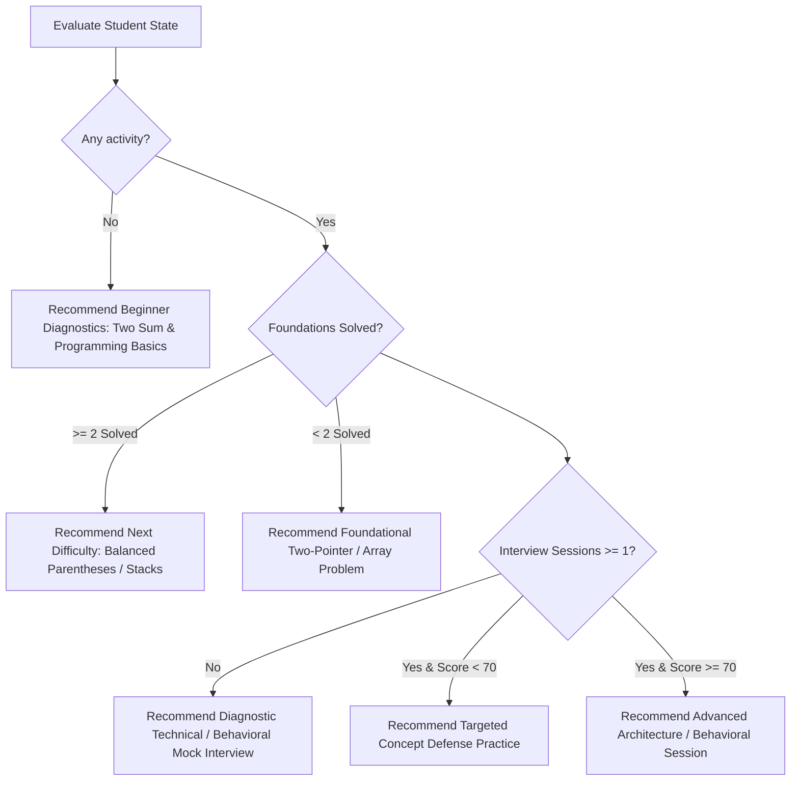

# Nexora Adaptive Recommendation Engine

## 1. Design Objectives

The Nexora Recommendation Engine answers the core student question:
> *"What should I do next, at what difficulty, and why?"*

Key design rules:
1. **Explainable Rationale**: Every recommendation includes a plain-text `reason` linking back to the student's recent performance or missing evidence.
2. **Deterministic Rules**: No stochastic or black-box algorithms. Recommendations are directly auditable.
3. **Actionable Triggers**: Every recommendation provides a direct action link (`/codelab/problem/:slug` or `/interview/setup?category=...`).
4. **Publishing Validation**: Recommendations only refer to real, accessible problems and interview categories published in the curriculum.

---

## 2. Recommendation Decision Matrix



---

## 3. Heuristic Rules

### Rule R1: On-Ramp for New Students
- **Condition**: `totalCodeLabAttempted === 0`
- **Target Skill**: `prog-fundamentals` / `prog-hash-tables`
- **Action**: Suggest `two-sum-indices` (difficulty: `beginner`).
- **Explanation**: *"No completed coding submissions detected yet. Start with this foundational problem to calibrate your problem-solving baseline."*

### Rule R2: Foundational Progression to Data Structures
- **Condition**: Student has solved >= 2 foundational problems (`prog-fundamentals` and `prog-strings-pointers` or `prog-hash-tables`).
- **Target Skill**: `prog-stacks-queues`
- **Action**: Suggest `valid-parentheses-depth` (difficulty: `intermediate`).
- **Explanation**: *"You have demonstrated consistent mastery on foundational arrays and hash lookups. Step up to intermediate LIFO stack validation."*

### Rule R3: Diagnostic Interview Recommendation
- **Condition**: `totalInterviewsCompleted === 0`
- **Target Skill**: `int-concept-articulation`
- **Action**: Suggest starting a Technical Mock Interview (difficulty: `beginner`).
- **Explanation**: *"No mock interview sessions recorded yet. Complete an initial diagnostic interview to assess communication clarity and concept articulation."*

### Rule R4: Technical Reinforcement on Lower Scores
- **Condition**: `averageInterviewScore !== null && averageInterviewScore < 70`
- **Target Skill**: `int-concept-articulation`
- **Action**: Suggest targeted Technical Mock Practice (difficulty: `intermediate`).
- **Explanation**: *"Recent interview evaluation score indicates opportunities to tighten technical trade-off articulation and edge-case handling."*

### Rule R5: Balanced Competencies (CodeLab vs InterviewAI)
- **Condition**: Student has high coding submissions (>= 3 accepted) but 0 interview sessions.
- **Target Skill**: `int-star-communication`
- **Action**: Suggest a Behavioral / System Design Interview session.
- **Explanation**: *"Strong coding output verified. Complement your implementation skills with mock interview experience to prepare for full-loop interviews."*

---

## 4. Recommendation Schema

```typescript
export interface AdaptiveRecommendation {
  id: string;
  userId: string;
  type: 'codelab_problem' | 'interview_session' | 'learning_path_milestone';
  targetSkillId: string;
  targetSkillName: string;
  title: string;
  difficulty: SkillLevel;
  reason: string;
  actionUrl: string;
  actionLabel: string;
  createdAt: string;
}
```

Recommendations are generated dynamically during `computeStudentAnalytics(userId)` and cached alongside the student's unified analytics document.

---

## 5. Phase 8 Enhancements: Dismissal & Topic Independence

1. **Dismissal & Deferral Persistence**:
   - Students can dismiss recommendations using the dismissal control.
   - Dismissals are saved to local storage (`nexora_dismissed_recs_{userId}`) and synced to Firestore `/users/{userId}/recommendationFeedback/{recId}`.
   - Dismissed items are excluded from future suggestion queues.

2. **Topic Independence**:
   - Recommendations evaluate topics orthogonally. Repeated difficulties in SQL do not depress Python or DSA difficulty levels.
   - The engine produces targeted revision problems for weak areas without resetting progress in mastered disciplines.

