# CodeXpertAI — Comprehensive SEO, GEO & AEO Audit Report

**Date:** 18 October 2026  
**Product:** CodeXpertAI  
**Creator/Publisher:** Nexora Techno  
**Corporate Attribution:** A product of Nexora Techno (`https://nexoratechno.in`)  
**Auditor:** Antigravity Engineering & Search Strategy Agent  

---

## 1. Executive Summary

CodeXpertAI is a unified developer platform combining structured coding practice (CodeLab) with AI-guided mock interviews (InterviewAI). This audit provides an exhaustive evaluation of the existing repository across Traditional Search Engine Optimization (SEO), Generative Engine Optimization (GEO), and Answer Engine Optimization (AEO).

The platform is designed to serve software developers, students, and job seekers. To achieve sustainable discovery across traditional search engines (Google, Bing), AI-powered synthesis engines (ChatGPT Search, Perplexity, Gemini, Claude), and direct question-and-answer search interfaces, the application requires technically sound infrastructure, clear corporate entity association, semantic content structuring, and robust crawl governance.

---

## 2. Technical Stack & Architecture Assessment

| Architecture Domain | Current Workspace Configuration | Implications for Search & Discovery |
| :--- | :--- | :--- |
| **Framework** | React 18.3.1, TypeScript 5.6.3 | Client-Side Rendered (CSR) Single Page Application (SPA). |
| **Build Tooling** | Vite 6.0.1 | Fast modular bundling; HTML templates located at `/index.html`. |
| **Routing System** | React Router DOM 6.28.0 | Client-side routing with nested `AppShell` and route guards (`ProtectedRoute`, `PublicOnlyRoute`, `AdminRoute`). |
| **Backend & Hosting** | Firebase Hosting (`nexoratechno-code`), Firestore, Cloud Functions v2 | Rewrite rules route all non-static paths to `/index.html`. Protected resources authenticated via Firebase Auth. |
| **Code Editor** | Monaco Editor (`@monaco-editor/react` 4.7.0) | Rich interactive browser IDE for algorithmic problem solving. |
| **Design System** | Modular Vanilla CSS (`*.module.css`) + CSS Custom Properties | Consistent dark mode theme (`#090909`), Inter and JetBrains Mono typography, responsive breakpoints. |

---

## 3. Current State Discovery & Defect Analysis

### 3.1 Routing & URL Structure
The platform currently defines the following routing topology:
- **Public Routes:**
  - `/` — Homepage / Landing Page
  - `/login` — Account sign in
  - `/signup` — Student registration
  - `/privacy` — Privacy Policy
  - `/terms` — Terms and Conditions
- **Protected Routes (Authenticated Only):**
  - `/dashboard` — Unified Student Analytics & Study Plan
  - `/codelab` — Practice catalog & topic overview
  - `/codelab/problems` — Algorithmic problem library
  - `/codelab/problems/:slug` — Monaco coding workspace
  - `/codelab/submissions` — User submission history
  - `/codelab/challenges` — Daily coding challenges & leaderboards
  - `/interview` — InterviewAI hub
  - `/interview/setup` — Mock interview configurator
  - `/interview/simulator` — Practice simulator
  - `/interview/live` — Active real-time AI interview session
  - `/interview/session/:id` — Completed session view
  - `/interview/report/:id` — Diagnostic evaluation report
  - `/learning-paths` — Structured multi-tier curriculum
  - `/profile` — Student profile & preference settings
  - `/admin` — Administrative user and problem management
- **Catch-all Route:**
  - `*` — 404 Not Found Page

#### Discovered Gaps:
1. **Absence of Dedicated Public Discovery Pages:** There is currently no public `/about` page, no dedicated `/faq` page, and no public educational `/guides` pages explaining coding practice methodologies or mock interview frameworks.
2. **Missing Robots Meta Directives:** Protected routes currently lack dynamic `<meta name="robots" content="noindex, nofollow" />` enforcement. If a crawler navigates beyond the SPA root, there is risk of indexing empty or redirect states.
3. **No Dynamic Title or Metadata Management:** When a user or crawler navigates between routes, `document.title` and meta tags in the document head are not updated dynamically.

### 3.2 HTML, Head & Metadata Audit
Inspection of `index.html` reveals:
- Static title: `<title>CodeXpertai — Unified CodeLab & InterviewAI Platform</title>` (note lowercase 'ai').
- Static description: `<meta name="description" content="CodeXpertai developer platform for structured coding practice and AI-powered technical interview preparation." />`.
- **Missing Elements in `index.html`:**
  - No `<link rel="canonical" href="...">` tag.
  - No Open Graph tags (`og:title`, `og:description`, `og:url`, `og:image`, `og:site_name`, `og:type`).
  - No Twitter Card tags (`twitter:card`, `twitter:title`, `twitter:description`, `twitter:image`).
  - No Schema.org JSON-LD structured data (`Organization`, `WebSite`, `SoftwareApplication`).
  - No social sharing preview image asset (`og-image.png`).

### 3.3 Crawl Governance & Indexing Infrastructure
- **`robots.txt`:** Absent from `/public`. Crawlers currently receive the fallback SPA HTML with HTTP 200, causing crawl ambiguity and wasting crawl budget.
- **`sitemap.xml`:** Absent from `/public`. Search engines cannot reliably discover canonical public pages or discern update frequencies.
- **`llms.txt`:** Absent from `/public`. AI retrieval engines and web agents have no concise, factual roadmap for entity resolution.
- **Private Route Protection:** Firebase Auth guards protect dashboard and interview data at runtime, and Firestore Security Rules protect data at the storage layer. However, crawler directives must explicitly prevent search engines from attempting to index authenticated URLs.

### 3.4 Brand Positioning & Entity Clarity
- **Brand Attribution:** The prompt defines the official brand relationship:
  > **CodeXpertAI is a product of Nexora Techno.**
- **Existing Site Independence:** Nexora Techno's corporate website is `https://nexoratechno.in`. It is strictly separate and must remain untouched.
- **Current Issues:**
  - In `src/components/layout/Footer.tsx`, the footer states `© 2026 CodeXpertai. All rights reserved.` without mentioning Nexora Techno or linking to `https://nexoratechno.in`.
  - Inconsistent capitalization across files: `CodeXpertai`, `Codexpert AI`, `Nexora CodeLab`, and `CodeXpertAI`. Standardizing to **CodeXpertAI** is required.
  - The landing page hero and navbar do not explicitly communicate the publisher relationship ("A product of Nexora Techno").

---

## 4. Competitive & Intent Analysis

CodeXpertAI operates at the intersection of two high-demand developer software segments:
1. **Interactive Coding Practice Platforms** (e.g., LeetCode, HackerRank, NeetCode): Dominated by keyword patterns like "coding practice", "algorithmic challenges", "Python coding practice", and "data structures practice".
2. **AI-Powered Technical Interview Simulators** (e.g., Interviewing.io, Pramp): Dominated by keywords like "AI mock interview", "technical interview preparation", "coding interview questions", and "STAR behavioral interview practice".

### Search Intent Matrix
| User Intent Group | Search Query Examples | Content Mapping on CodeXpertAI |
| :--- | :--- | :--- |
| **Navigational (Brand)** | "CodeXpertAI", "Nexora CodeXpertAI", "CodeXpert AI mock interview" | Home, About, FAQ, Features |
| **Informational (Practice)** | "how to practice coding effectively", "interpreting coding test results" | Educational Guides, CodeLab overview |
| **Informational (Interview)** | "how AI mock interviews work", "technical interview questions preparation" | InterviewAI overview, FAQ, Guides |
| **Transactional / Sign-up** | "practice programming online free", "mock coding interview platform" | Landing Page CTAs, Signup Page |

---

## 5. Core Recommendations & Remediation Plan

```mermaid
graph TD
    A[CodeXpertAI SEO & Discovery Engine] --> B[Phase 2: Brand Identity]
    A --> C[Phase 3: Traditional Technical SEO]
    A --> D[Phase 4: GEO Entity & Education]
    A --> E[Phase 5: AEO & Structured Data]
    A --> F[Phase 7: Security & Crawl Governance]

    B --> B1[Footer Attribution: A product of Nexora Techno]
    B --> B2[Link to nexoratechno.in]
    B --> B3[Standardize CodeXpertAI capitalization]

    C --> C1[robots.txt & sitemap.xml in /public]
    C --> C2[SEOHead Component for dynamic tags]
    C --> C3[Canonical URLs & Open Graph image]

    D --> D1[Public /about page with verified entity data]
    D --> D2[Public /guides with educational resources]
    D --> D3[llms.txt factual index]

    E --> E1[Public /faq page & Home FAQ preview]
    E --> E2[JSON-LD: Organization, WebSite, SoftwareApplication]
    E --> E3[JSON-LD: FAQPage & BreadcrumbList]

    F --> F1[Strict noindex on all authenticated routes]
    F --> F2[Preserve Firebase auth & data isolation]
    F --> F3[Keep nexoratechno.in 100% untouched]
```

### Action Items & Implementation Phases:
1. **Head & Metadata Architecture:** Build a robust `SEOHead` component that dynamically manages document title, canonical links, meta descriptions, Open Graph, Twitter cards, and Schema.org JSON-LD.
2. **Crawl Governance:** Implement `public/robots.txt`, `public/sitemap.xml`, and `public/llms.txt`.
3. **Brand Attribution:** Update `Footer.tsx`, `Navbar.tsx`, `LandingPage.tsx`, and legal headers to clearly state "A product of Nexora Techno" with verified links to `https://nexoratechno.in`.
4. **Public Content Strategy:**
   - Create `/about` answering core entity questions.
   - Create `/faq` with direct answers and Schema.org `FAQPage` markup.
   - Create `/guides` hub with 3 comprehensive, original technical guides for developers.
5. **Route Registration & Guarding:** Update `router.tsx` to expose the new public routes while ensuring all private dashboard, problem workspace, and interview report routes enforce `noindex, nofollow`.
6. **Social Assets:** Generate and deploy an optimized Open Graph social preview card (`/og-image.png`).
7. **Validation & Verification:** Validate structured data with Schema.org specifications, check TypeScript compilation, run automated unit test suites, and generate documentation.
