# Nexora Unified Skill Taxonomy & Mapping Model

## 1. Overview & Architectural Purpose

The **Nexora Unified Skill Taxonomy** provides a single, consistent competency graph shared across **Nexora CodeLab** (objective compiler/runtime execution) and **Nexora InterviewAI** (subjective AI-assisted mock interviews). 

Rather than maintaining separate silos or inventing ungrounded scores, this unified taxonomy grounds every skill in verified student actions.

---

## 2. Taxonomy Structure

The taxonomy organizes engineering competencies into four major categories:

```mermaid
graph TD
  Taxonomy[Unified Skill Taxonomy] --> Cat1[1. Programming Fundamentals]
  Taxonomy --> Cat2[2. Programming Languages]
  Taxonomy --> Cat3[3. Databases & SQL]
  Taxonomy --> Cat4[4. Technical & Interview Skills]

  Cat1 --> S1[Variables, Control Flow & Functions]
  Cat1 --> S2[Two Pointers & String Parsing]
  Cat1 --> S3[Hash Tables & Fast Lookup]
  Cat1 --> S4[LIFO Stacks & FIFO Queues]
  Cat1 --> S5[Linked Lists & Pointers]
  Cat1 --> S6[Time & Space Complexity O-Notation]
  Cat1 --> S7[Heaps & Priority Queues]

  Cat2 --> L1[Python 3]
  Cat2 --> L2[JavaScript / Node.js]
  Cat2 --> L3[Java / JVM]
  Cat2 --> L4[ANSI SQL / Relational Engine]

  Cat3 --> D1[SQL Filtering, Joins & Grouping]
  Cat3 --> D2[Relational Schema & Foreign Keys]
  Cat3 --> D3[B-Tree Indexes & Execution Plans]
  Cat3 --> D4[ACID Concurrency & Transactions]

  Cat4 --> I1[Core CS Concept Articulation]
  Cat4 --> I2[Trade-Offs & Edge Cases]
  Cat4 --> I3[STAR Behavioral Communication]
```

---

## 3. Stable Skill Identifiers & Metadata

Every skill is defined with:
- `id`: Stable, immutable string identifier (e.g. `prog-hash-tables`, `lang-python`, `int-star-communication`).
- `name`: Human-readable title.
- `category`: One of `programming_fundamentals`, `programming_languages`, `databases_and_sql`, `interview_skills`.
- `description`: Plain-language explanation of what mastery in this skill entails.
- `prerequisites`: Array of prerequisite skill IDs.
- `suggestedLevel`: Target difficulty (`absolute_beginner`, `beginner`, `intermediate`, `advanced`, `expert`).
- `relatedCodeLabTopics`: CodeLab topic IDs associated with this skill.
- `relatedInterviewCategories`: InterviewAI categories mapping to this skill (`technical`, `programming`, `sql`, `behavioral`).

### Complete Skill Directory

| Skill ID | Category | Name | Prerequisites | Target Level |
| :--- | :--- | :--- | :--- | :--- |
| `prog-fundamentals` | `programming_fundamentals` | Variables, Control Flow & Functions | `[]` | Absolute Beginner |
| `prog-strings-pointers` | `programming_fundamentals` | Two Pointers & In-Place String Mutation | `['prog-fundamentals']` | Beginner |
| `prog-hash-tables` | `programming_fundamentals` | Hash Tables & Fast O(1) Lookups | `['prog-fundamentals']` | Beginner |
| `prog-stacks-queues` | `programming_fundamentals` | Stacks, Queues & Parsing Logic | `['prog-fundamentals']` | Intermediate |
| `prog-linked-lists` | `programming_fundamentals` | Linked Lists & Pointer Traversal | `['prog-fundamentals']` | Intermediate |
| `prog-complexity` | `programming_fundamentals` | Big-O Time & Space Complexity | `['prog-fundamentals']` | Beginner |
| `prog-advanced-heaps` | `programming_fundamentals` | Priority Queues & Divide-and-Conquer | `['prog-stacks-queues']` | Expert |
| `lang-python` | `programming_languages` | Python Foundations & Idioms | `['prog-fundamentals']` | Beginner |
| `lang-javascript` | `programming_languages` | JavaScript Runtimes & Async Mechanics | `['prog-fundamentals']` | Beginner |
| `lang-java` | `programming_languages` | Java Object-Oriented Structures & JVM | `['prog-fundamentals']` | Intermediate |
| `lang-sql` | `programming_languages` | Relational Query Dialects (ANSI SQL) | `[]` | Beginner |
| `db-filtering-aggregations` | `databases_and_sql` | Filtering, Grouping & Window Aggregations | `['lang-sql']` | Beginner |
| `db-joins-relations` | `databases_and_sql` | Relational Joins & Set Operations | `['lang-sql']` | Intermediate |
| `db-indexing-performance` | `databases_and_sql` | B-Tree Indexes & Execution Plan Analysis | `['db-filtering-aggregations']` | Intermediate |
| `db-transactions-acid` | `databases_and_sql` | ACID Transactions & Concurrency Control | `['db-joins-relations']` | Advanced |
| `int-concept-articulation` | `interview_skills` | CS Concept & Architecture Articulation | `['prog-fundamentals']` | Intermediate |
| `int-tradeoff-reasoning` | `interview_skills` | Trade-Offs, Constraints & Edge Cases | `['prog-complexity']` | Intermediate |
| `int-star-communication` | `interview_skills` | STAR Behavioral Narrative & Ownership | `[]` | Beginner |

---

## 4. Problem & Interview Mapping Functions

Mappings are deterministic and maintained in `src/data/skillTaxonomy.ts`:

1. **`getSkillsForProblem(problem: Problem): string[]`**
   - Maps problem tags (e.g. `'strings'`, `'two pointers'`, `'hash table'`, `'stack'`, `'doubly-linked list'`) and topic IDs (`'arrays-strings'`, `'hash-maps-sets'`, `'stacks-queues'`) to stable skill IDs.
   - Every problem automatically assigns foundational baseline skills (`prog-fundamentals`, `prog-complexity`) alongside specialized structural skills.

2. **`getSkillsForInterview(category: InterviewCategory, topic?: string): string[]`**
   - `technical` category maps to `int-concept-articulation`, `int-tradeoff-reasoning`, `prog-complexity`.
   - `programming` category maps to `prog-fundamentals`, `prog-complexity`, `int-tradeoff-reasoning`.
   - `sql` category maps to `lang-sql`, `db-joins-relations`, `db-filtering-aggregations`, and optionally `db-indexing-performance`.
   - `behavioral` and `hr` categories map to `int-star-communication`.

---

## 5. Non-Overstatement Guarantee

The unified skill taxonomy explicitly rejects false claims of universal mastery:
- Completing a single Python problem does **not** grant complete Python language mastery.
- Answering one behavioral question does **not** certify executive leadership communication.
- Mastery estimates are strictly topic-specific, separating compiler-verified unit test outcomes from AI-evaluated conversational responses.
